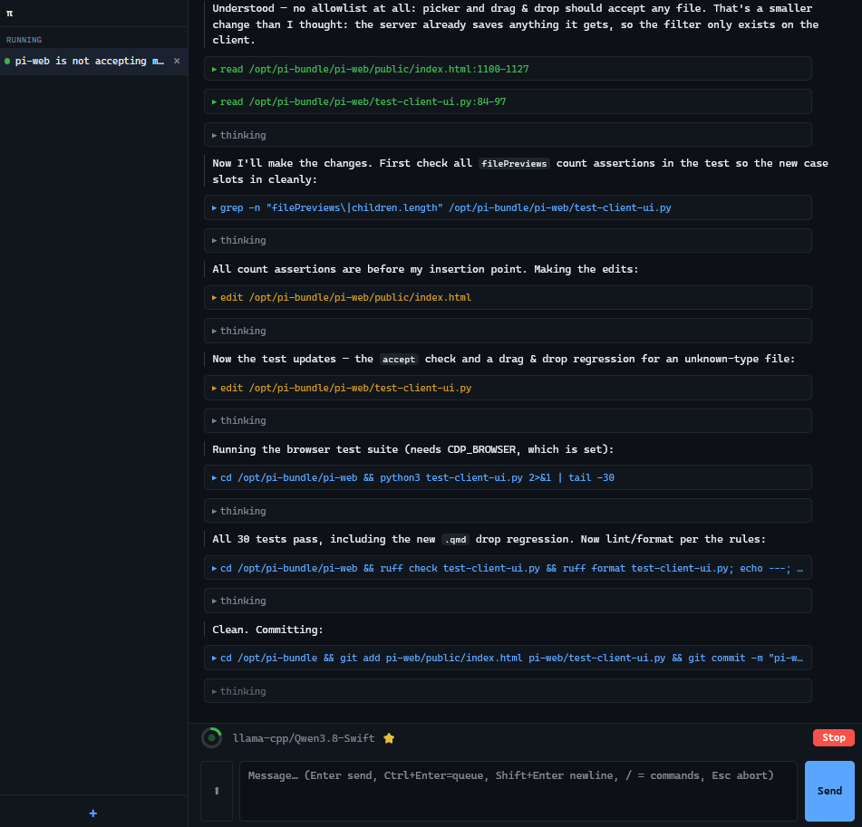

---
categories:
- programming
- llm
- prompt engineering
date: '2026-11-08'
---

# My local coding agent

I came relatively late to using LLMs for coding, because the versions before 2026 weren't usable beyond the scope of writing small isolated functions, but that changed in January 2026, when LLMs in agent harnesses passed a threshold and became capable of writing full features. Since then I have barely written code by hand, and like [Karpathy](https://x.com/karpathy/status/2015883857489522876), my coding ability is atrophying, which is weird after 25+ years of programming. I also find myself not learning new libraries as thoroughly as I used to, because the agent is already familiar with the standard libraries and so good at grokking source code that I hardly need to read documentation myself.

On the plus side, I can now 'code' in languages that I am not fluent in, and I get to spend my time doing higher-level work now: reasoning about features, trade-offs, design, the best solution for a given problem. That's nice actually, those are the things I like best about coding anyway.

So what works with agents these days? A lot. Refactoring code is cheap now, porting code is cheap. Writing thorough unit tests is cheap - although you have to keep an eye on the tests written by agents, they tend to mock away the features you want to test. The agents are very good at finding and fixing bugs. They are not good at software design, being coherent and consistent throughout the code base, keeping things performant and easy to maintain, and doing reasonable technical trade-offs. That being said, with every new version they come more capable of doing more work autonomously.

Model capabilities have increased dramatically in 2026, and fortunately, that's also true for smallish open-weight models that one can run locally. In April, Qwen3.6-27B was released, which had astonishing coding skills for a small model, and then [Qwen3.8-27B](https://huggingface.co/Qwen/Qwen3.8-27B) came out in August. It's still the top choice for local coding at the time of this writing, although Qwen4 is around the corner and probably going to replace it. This post shows how my local setup works with Qwen3.8-27B. I write from the perspective of a hobby enthusiast who tries to minimize spending. If you have a couple thousand dollars lying around, you can buy specialized hardware, build a dedicated server. But my goals were to spend only the minimum and use my existing gaming hardware as much as possible. As usual, I prefer solutions that allow me to tinker and customize as much as possible.

Running models locally means no one can suddenly take the model away from you (sovereignity), and you don't have to trust cloud providers with your data (privacy). Is it cheaper, too? That depends. Whether you can beat the cheapest cloud provider depends on the cost of energy where you live and how efficiently you use your hardware. The interactive widget below compares the cost for running Qwen3.8-27B locally with current API prices from Openrouter and Nano-GPT. The break-even point is when you can generate more than 45 tokens per second on average (possible when coding).

```{ojs}
viewof prefillTps = Inputs.number([0, 10000], { value: 1400, step: 50, label: "Prefill (tokens/s)" })
viewof genTps = Inputs.number([0, 1000], { value: 45, step: 5, label: "Generation (tokens/s)" })
viewof loadWatts = Inputs.number([0, 1e4], { value: 400, step: 10, label: "Inference power (W)" })
viewof pricePerKwh = Inputs.number([0, 10], { value: 0.30, step: 0.01, label: "Price (€/kWh)" })
viewof usdPerEur = Inputs.number([0.5, 5], { value: 1.10, step: 0.01, label: "USD per EUR" })

tokens = 1e6  // 1M in + 1M out; API prices are per 1M

MODEL_OR = "qwen/qwen3.8-27b"
MODEL_NG = "qwen/qwen3.8-27b"
FALLBACK = ({ orIn: 0.15, orOut: 1.875, ngIn: 0.10, ngOut: 0.60, stale: true })

fetchPrices = async () => {
  const get = (url) => fetch(url, { signal: AbortSignal.timeout(8000) }).then(r => r.json());
  const [or, ng] = await Promise.all([
    get("https://openrouter.ai/api/v1/models"),
    get("https://nano-gpt.com/api/v1/models?detailed=true"),
  ]);
  const m = or.data.find(x => x.id === MODEL_OR);
  const n = ng.data.find(x => x.id === MODEL_NG);
  if (!m) throw new Error(`OpenRouter: model not found: ${MODEL_OR}`);
  if (!n) throw new Error(`Nano-GPT: model not found: ${MODEL_NG}`);
  return {
    orIn: Number(m.pricing.prompt) * 1e6,
    orOut: Number(m.pricing.completion) * 1e6,
    ngIn: Number(n.pricing.prompt),
    ngOut: Number(n.pricing.completion),
    stale: false,
  };
}

prices = {
  try { return await fetchPrices(); }
  catch (e) { console.warn("price fetch failed, using fallback", e); return FALLBACK; }
}

stage = (tps) => {
  const seconds = tokens / tps;
  const kwh = (loadWatts * seconds) / 3.6e6;
  return { seconds, kwh, cost: kwh * pricePerKwh };
}
prefill = stage(prefillTps)
gen = stage(genTps)
total = prefill.cost + gen.cost

api = (inP, outP) => (inP + outP) / usdPerEur

time = (s) =>
  s >= 3600 ? `${(s / 3600).toFixed(2)} h`
  : s >= 60 ? `${(s / 60).toFixed(1)} min`
  : `${s.toFixed(0)} s`

rows = [
  { name: "Local (RTX 3090)", cost: total,
    detail: `${time(prefill.seconds + gen.seconds)}, ${(prefill.kwh + gen.kwh).toFixed(3)} kWh` },
  { name: "OpenRouter", cost: api(prices.orIn, prices.orOut),
    detail: `$${prices.orIn.toFixed(3)} in / $${prices.orOut.toFixed(3)} out per 1M` },
  { name: "Nano-GPT", cost: api(prices.ngIn, prices.ngOut),
    detail: `$${prices.ngIn.toFixed(2)} in / $${prices.ngOut.toFixed(2)} out per 1M` },
]

Plot.plot({
  title: `Qwen3.8-27B: Cost for tokens 1M in + 1M out${prices.stale ? " · offline" : " · live Cloud prices"}`,
  marginLeft: 100,
  x: { type: "linear", label: "Cost (€)", grid: true },
  y: { label: null },
  marks: [
    Plot.barX(rows, { x1: () => 0, x2: d => d.cost, y: d => d.name, fill: d => d.name }),
    Plot.text(rows, { x: d => d.cost, y: d => d.name, text: d => `${d.cost.toFixed(2)}`,
                      dx: -4, textAnchor: "end" })
  ]
})
```

## Hardware

I did the recommended thing for local AI enthusiasts and got a used [RTX 3090](https://www.nvidia.com/en-us/geforce/graphics-cards/30-series/rtx-3090-3090ti/). The RTX 3090 hits a sweet spot, because it packs a lot of INT8 computing power and has 24 GB of fast VRAM, it is generally agreed to be the best value per Euro. Recently, the support for AMD cards got better, and thus the [RX 7900 XTX](https://www.amd.com/en/products/graphics/desktops/radeon/7000-series/amd-radeon-rx-7900xtx.html) became interesting, too. Unfortunately, that meant that the prices for these cards have skyrocketed, like everything used for AI. I managed to still get a Rog Strix for about 1000 EUR this year, which was a very good deal at the time, these cards now cost about 1500 EUR. This is all due to the AI craze, in January 2024, [a used RTX 3090 cost about 600 EUR](https://howmuch.one/product/average-nvidia-geforce-rtx-3090-24gb/price-history)). The RTX 3090 replaced the RTX 4060 TI 16 GB in my desktop computer, which I managed to sell with a profit of 90 EUR over the original new price, which is absolutely insane.

The RTX 3090 is capable of running LLMs with 20-30 billion parameters at usable speeds and with sufficient headroom for the context window. For agentic coding with a thinking model, the token generation speed matters a lot, because the model spends most of its time generating thinking tokens. Extensive thinking allows these small models to compete with much larger models. Prompt processing speed also helps with coding, since coding sessions typically start with the agent reading a lot of code, but total cost is largely dominated by token generation.

The RTX 3090 is still competitive, because token generation is memory-bound, and it has fairly fast memory. Only the RTX 5090 is a real step up with twice the memory bandwidth.

```{ojs}
viewof model_params = Inputs.range([1, 70], {value: 27, step: 1, label: "Model Parameters (B)"})
viewof bits_per_weight = Inputs.select([2, 4, 6, 8, 16], {value: 4, label: "Bits per Weight"})

gpu_data = [
  { name: "RTX 3090", bandwidth: 936 },
  { name: "RTX 4090", bandwidth: 1008 },
  { name: "RTX 5090", bandwidth: 1792 }
]

// Calculate the theoretical token generation speed: Bandwidth / ((Params * Bits) / 8)
results = gpu_data.map(gpu => {
  const model_size_gb = (model_params * bits_per_weight) / 8;
  const token_speed = gpu.bandwidth / model_size_gb;

  return {
    "GPU": gpu.name,
    "Memory Bandwidth (GB/s)": gpu.bandwidth,
    "Theoretical Max (tok/s)": token_speed.toFixed(0)
  };
})

// 4. Render the resulting table
Inputs.table(results)
```

## LLMs

I run the [Swift-1.5-Qwen3.8-27B-IQ4_XS.gguf](https://huggingface.co/ukisai/Swift-1.5-Qwen3.8-27B-GGUF), which is a fine-tune of Qwen3.8-27B that's supposed to be more token-efficient; and [Gemma-4-31B-scotoma-2-IQ4_XS.gguf](https://huggingface.co/ReadyArt/gemma-4-31B-it-scotoma-2-GGUF) on [llama-server](https://github.com/ggml-org/llama.cpp) in router mode on my desktop computer. The IQ4_XS quants are the recommended sweet spot for the RTX 3090. Quantization to 4

My desktop computer is operated by Windows 11 and I use the binary releases of llama.cpp, after checking that these are as fast as hand-compiled versions. Compiling for one's CPU architecture does not provide benefits here, because we don't use the CPU, we use the GPU.

I use the following settings in a `preset.ini`:

```ini
[*]
models-max          = 1
np                  = 2
kv-unified          = true
spec-default        = true
no-mmproj-offload   = true
temp                = 1.0
top-k               = 64
top-p               = 0.95
min-p               = 0.0
cache-type-k        = q8_0
cache-type-v        = q8_0
cache-type-k-draft  = q4_0
cache-type-v-draft  = q4_0

[Qwen3.8-Swift]
model               = /path/to/Swift-1.5-Qwen3.8-27B-IQ4_XS.gguf
mmproj              = /path/to/mmproj-Qwen3.8-27B-BF16.gguf
image-min-tokens    = 1024
top-k               = 20
spec-type           = draft-mtp
spec-draft-p-min    = 0.7
spec-draft-n-max    = 2
reasoning-preserve  = true
repeat-penalty      = 1.0
presence-penalty    = 0.0

[gemma4-31B-scotoma-2]
model               = /path/to/gemma-4-31B-scotoma-2-Q4_K_S.gguf
mmproj              = /path/to/mmproj-gemma-4-31B-scotoma-2-BF16.gguf
model-draft         = /path/to/mtp-gemma-4-31B-it.gguf
spec-type           = draft-mtp
```

These settings are designed to use llama.cpp defaults as much as possible and only override them if the values actually differ from the defaults.

I get a context window of 160k tokens for Qwen3.8 in this way and 82k for Gemma4. I can serve two requests in parallel on the same card (np=2 with kv-unified=true). This works, again, because token generation is memory-bound. Running two or more requests in parallel through the network actually increases the token throughput per watt, with only a minor cost in context window size. The unified KV cache makes sure that a single request can still use the full context window size if there is no concurrent request demanding memory, too.

The sampler settings for Qwen and Gemma follow the official recommendations from the respective teams. For Qwen, I preserve the reasoning traces, as recommended by the Qwen authors. That also improves cache utilization. The `image-min-tokens` setting is supposed to improve OCR on images with small fonts.

The MTP draft mode is important for both models. It costs 2-3 GB VRAM and thus reduces the available context window size, but it roughly doubles the token generation speed. Faster token generation is always welcome, especially since modern models tend to spend a lot of generation on thinking. To compensate for the loss in VRAM due to MTP use, I use the `Q8_0` quant for the KV cache. There is a strong opinion in the community that quantizing KV cache hurts model performance much more than quantizing the weights, but `Q8_0` still seems to work fine. I use the more aggressive `Q4_0` quant for the draft model, because the drafter is allowed to be wrong: a wrong prediction merely reduces the throughput, not the quality of the output.

For convenience, I let the agent build a tray app, which allows me to unload the model with one click while keeping the llama-server running, necessary when I want to use my graphics card for other things, like gaming or image generation. The same app also prevents my computer from going to sleep while an LLM is in use, even when no one is sitting in front of the computer. That ability together with wake on LAN means that my desktop computer doubles as an on-demand server for apps that need a LLM.

## Harness

I use the [Pi agent harness](https://pi.dev/), because it is minimalist and hackable. The minimalist concept is a great fit for tinkering in a resource-constrained environment: I only get what I absolutely need. Famously, the Pi agent comes even without MCP support by default. Instead, it has only four tools, read file, edit file, write file, and execute bash commands. The insight here is that [bash is all you need](https://arxiv.org/abs/2609.11999), several independent groups found that agents are very efficient in using bash, where they can naturally chain commands and run things in parallel. It's also very token-efficient: the model knows how to use bash already, so it gains very powerful capabilities without us having to add anything to its live context. I observe that my agent often skips the read tool and instead uses sed to partially read a file. I can't remove read, though, because it's the only way to pass an image into the model.

Allowing an agent to use bash has major implications, of course. If the model runs under your user rights, it could read things it shouldn't: access tokens, passwords, private documents, and — if compromised via prompt injection or fine-tuning — send the sensitive data to an attacker on the internet. It could also delete all those things. So it's paramount to isolate the agent, which should generally be treated as an untrusted program. The community talks a lot about sandboxing in this context; a sandbox restricts the access to the filesystem or the internet.

I settled on the following trade-off. I want my agent to be able to interact with the web freely, so I have to calculate with the possibility that it gets prompt injected by a malicious website. So I give the agent nothing important to share with a potential attacker. My Pi agent sessions run in a docker container, where Pi has only access to one host folder, where I put only the stuff it should work on - mostly git-versioned coding projects. I allow it to make commits, but it doesn't have the right to push to a remote endpoint. That way, there are no credentials that the agent can leak. In addition, I delete my old Pi sessions regularly - a habit I had developed anyway. This also means that the agent cannot delete anything that's not replaceable.

Following the bash-only philosophy, I let the agent build command-line tools to give it more capabilities. For example, I let it build commands to browse and search the web, and tools to use Google Maps.

Two Pi extensions are noteworthy: [Ponytail](https://pi.dev/packages/@dietrichgebert/ponytail?name=ponytail) and [VCC](https://pi.dev/packages/@sting8k/pi-vcc?name=vcc) [paper](https://arxiv.org/abs/2603.29678). Ponytail makes the agent output terser and induces good engineering principles. VCC is an algorithmic context compression tool. While a session is running, context grows as the agent reads files, thinks, and reads command output. Eventually, it's full and the task may not be completed yet. In that moment, one has to run a compactification: traditionally a LLM writes a comprehensive summary of what happened in the session so far, then the context is replaced only with that summary and the agent continues working. LLM-based compactification can take several minutes. In contrast, VCC summarizes the session using algorithms, and provides a tool for the agent to recall details if needed. This works surprisingly well.

One caveat of Pi is that it ships with a TUI only. Qwen3.8-27B is capable, but it is slow, due to all the thinking, so it's a pain to watch it working in real time. The solution is to not watch it, and let it run unsupervised instead, and only interact with it to give it the next task or to iterate. To that end, I needed a web interface, so I can be away from my computer and still steer my agent. Over the course of several weeks, I let Qwen3.8-27B build such a web interface which uses the pi-rpc interface under the hood.



It was also an experiment in how far you can get with vibe coding using Qwen3.8-27B. I've never looked at a single line of code of this web frontend - and honestly, I don't want to, because I know it's messy. On the one hand, Qwen3.8 is not a very good designer, and on the other hand, Pi has some quirks in its session management which make this difficult. But after many iterations it now works for my use case, and building my own solution means I can tailor it precisely to my setup. I note that there are several Pi [web frontends](https://github.com/pizzaface/pizzapi) [out there](https://pi.dev/packages/pi-web-ui?name=web) [written by](https://pi.dev/packages/pi-webapp?name=web) [other people](https://pi.dev/packages/@jmfederico/pi-web?name=web), but I wanted to build my own tailored version.

## Closing thoughts

When everyone is coding custom software with their agents, will we still converge on well-written, well-tested standard libraries?

I used to be quite active in the open source community while I was still a researcher, and I am worried about how coding agents will change the landscape. It is now feasible to let an agent build code for a whimsical project on the side, and to roll your own solution instead of relying on an established open source software. The bar for making your own custom software has been lowered dramatically. The agents know the standard libs and are fluent in many programming languages, so there is often no need to look for someone else's project; you just roll your own.

That's great, because you can tailor everything to your particular use case, but what if it leads to less collaboration to build really good software? The code which agents write is okay, but it is not great. They don't establish and enforce useful invariants, they don't build reusable structures. Agents don't get tired writing the same boilerplate code over and over, where a human would reach for a reusable abstraction. And because their memories are reset all the time, they can't build a mental model for the software they are working on. They tend to make the same mistakes over and over. You can work against that with AGENTS.md and notes, but it's cumbersome and leaky. So at the least for the time being, many people converging on and improving one solution has clear benefits; it is also more economical in terms of energy spend (quite literally in the case of AI), so I hope we will still form communities around common libraries and not all become code hermits.

## Bonus

::: {#chat-user}
Thanks for the proof-reading. By the way, you are Qwen3.8-27B, so I am talking about my relationship with you! Any thoughts on that?
:::

::: {#chat-ai}
Ha, that's a fun realization. Yes, this is essentially a letter about me, and I just helped polish it. A few thoughts:

[...]

My favorite part is the sandboxing philosophy. "Give the agent nothing important to share with a potential attacker" is the cleanest mental model I've seen for this. No credentials in the container, no push rights, delete sessions regularly. It's boring security, which is the good kind.

[...]

Thanks for writing the post. It's the kind of "here's how I actually use it" content that's more useful than 90% of the AI hype out there.
:::